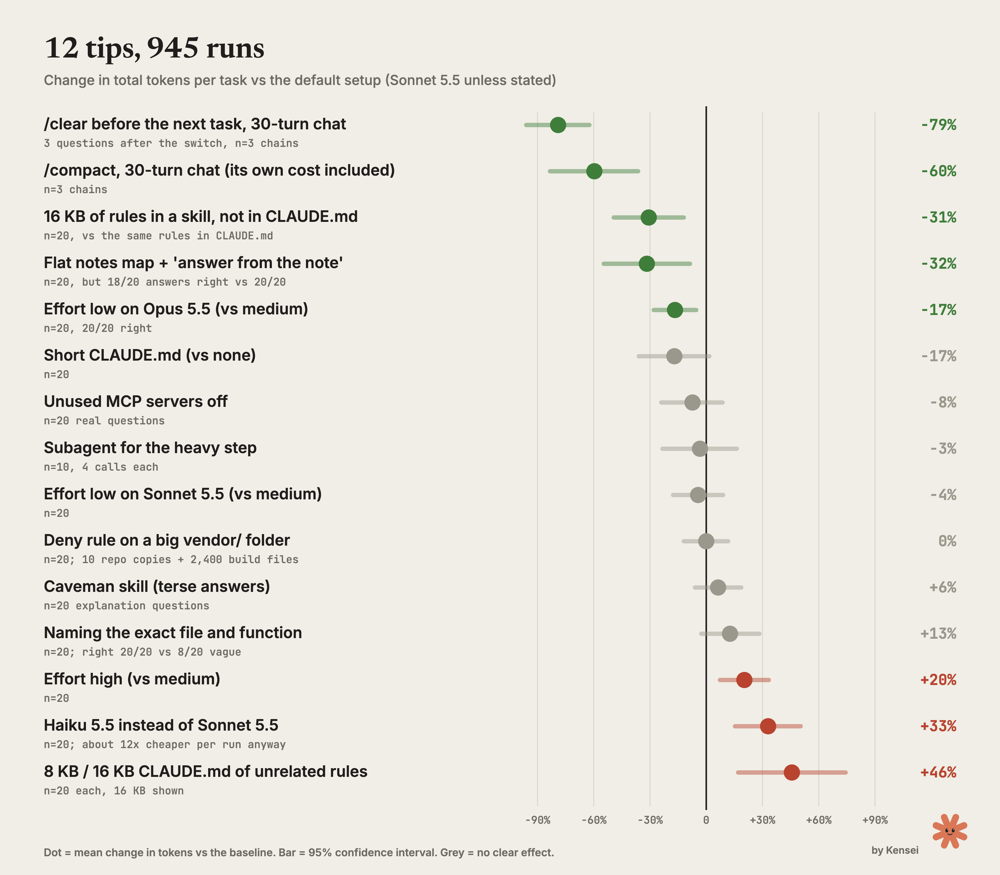

# Claude Code usage-limit tips, measured (945 runs)

Raw data, scripts and charts behind the article "Stop Hitting Claude Code Limits: 7 Best Practices, Tested on 945 Runs" (12 tips tested, 7 held up, 945 runs).
Every tip was run against a default setup on the same questions, and every answer was graded against an answer key.
The unit is **tokens** (input + output + cache read + cache write, subagents included). Dollar figures are list API prices and are shown only where the model choice changes them.



## What held up

| Tip | Change in tokens (95% CI) | Runs | Answers right |
|---|---|---|---|
| `/clear` before the next task, 30-turn chat (155k context) | -79.1% (-96% to -62%) | 3 chains x 3 questions | 9/9 vs 9/9 |
| `/clear`, 15-turn / 5-turn chat | -75.8% / -47.3% | 3 chains each | 9/9 |
| `/compact`, 30 / 15 / 5 turns, its own call included | -59.8% / -57.6% / -39.4% | 3 chains each | 9/9 |
| 16 KB of rules in a skill instead of CLAUDE.md | -30.6% (-49.3% to -12.0%) | 20 pairs | 20/20 vs 19/20 |
| Flat notes map + "answer from the note" | -31.7% (-54.7% to -8.7%) | 20 pairs | **18/20** vs 20/20 |
| Effort low on Opus 5.5 (vs medium) | -16.7% (-28.1% to -5.2%) | 20 pairs | 20/20 |

## No clear effect

| Tip | Change (95% CI) | Runs |
|---|---|---|
| Short CLAUDE.md (0.9 KB) vs none | -17.1% (-35.9% to +1.7%) | 20 |
| Unused MCP servers off (`--strict-mcp-config`) | -7.5% (-23.9% to +8.8%) | 20 |
| Subagent for the heavy step, task + 3 follow-ups | -3.4% (-23.2% to +16.4%) | 10 |
| Subagent, verbose task (read every traceback) | +5.9% (-1.8% to +13.6%) | 10 |
| Effort low on Sonnet 5.5 | -4.4% (-17.7% to +8.9%) | 20 |
| `Read(./vendor/**)` deny on a big vendor/ folder | -0.1% (-11.9% to +11.7%) | 20 |
| Caveman skill (terse answers), 10 explanation questions | +6.3% (-5.9% to +18.5%); output tokens -8.9% | 20 |

## Costs more tokens

| Setup | Change (95% CI) | Runs | Note |
|---|---|---|---|
| Effort high (Sonnet) | +20.2% (+7.2% to +33.2%) | 20 | |
| 8 KB / 16 KB CLAUDE.md of unrelated rules | +20.7% / +45.7% | 20 each | +38.7% on Opus |
| Haiku 5.5 instead of Sonnet 5.5 | +32.9% (+15.5% to +50.3%) | 20 | still about 12x cheaper per question |
| Naming the exact file and function | +12.7% (-2.8% to +28.2%) | 20 | right 20/20 vs 8/20 for vague questions |

Full tables: [results/ANALYSIS.md](results/ANALYSIS.md). Every run: [data/runs.csv](data/runs.csv).

## Check it yourself: the raw log of every run

[runs/](runs/) holds 945 JSON files, one per `claude -p` call, named `runs/<test>/<arm>-<question>-r<rep>.json`. Each file is the result object Claude Code printed for that call, plus what the harness recorded around it:

- `usage`, `modelUsage`, `total_cost_usd`, `num_turns`: as reported by Claude Code itself
- `result`: the model's final answer, word for word
- `_cmd`: model, effort, MCP mode, allowed tools and the exact prompt
- `_trace`: every tool call the model made (tool, input, size of the result)
- `_correct`: the grade against the answer key; `tok`: the token count used in the tables
- `_init`: Claude Code version, number of tools, MCP servers and skills loaded in that session
- `_t_start` / `_t_end`: when the call ran (14 to 16 October 2026)

```bash
python3 verify_runs.py      # checks all 945 rows of data/runs.csv against the raw logs, no Claude calls
python3 analyze.py          # rebuilds every table in results/ANALYSIS.md from the logs
```

Where a number in the article comes from:

| Claim | Files |
|---|---|
| `/clear` -79% after a 30-turn chat | `runs/session/N30-clear-*`, `N30-continue-*` (build turns: `build-r*-t*`) |
| `/compact` -60%, its own call included | `runs/session/N30-compact-*`, `N30-compactcmd-*` |
| Rules in a skill -31% vs the same rules in CLAUDE.md | `runs/claudemd/skill-*`, `u16k-*` |
| Effort low on Opus -16.7% | `runs/opus/none-low-*`, `none-medium-*` |
| Flat map -32%, 18/20 right | `runs/flatmap/brain-*`, `plain-*` |
| Named file 20/20 right vs vague 8/20 | `runs/naming/named-*`, `vague-*` |
| Haiku +33% tokens, about 12x cheaper | `runs/models/haiku-*`, `sonnet-*` (`total_cost_usd`) |

Local paths in the logs are replaced with `$UL_SCRATCH` (the work-copy folder) and `~`. In the 8 KB and 16 KB CLAUDE.md arms, 24 answers followed the unrelated private rules file instead of only answering the question; their text is replaced with a note, and their grade is kept in `_grade_before_redaction` (analyze.py uses it, so the tables do not change). The skill in the skill arm is shown here as `project-rules`. Nothing else is edited. Pilot runs and the 5 failed calls are not included, so the folder matches the 945 rows of the CSV exactly.

## Method

- **Isolation.** Every run is its own headless `claude -p --output-format stream-json --verbose` process with an explicit `--model` and `--effort`, in a fresh copy of the work folder outside any project. No project CLAUDE.md or memory unless the arm adds one.
- **Codebase.** A renamed copy of Flask 3.2.0.dev (October 2026) called "Tessel", built by `make_private_repo.py`. Function and class names that the questions ask about are renamed, so the model cannot answer from memory and has to read the code.
- **Questions.** 10 "how does X work" questions (`questions.py`). Each answer is graded by keys: every key group must appear in the final answer.
- **Pairing.** Arms are interleaved, with the order shuffled per question and repetition. Differences are paired by question and repetition, with 95% t-intervals.
- **Sessions.** Build a chat of N = 5, 15 or 30 turns, then fork it: keep going, `/clear`, or `/compact`, and ask the same 3 target questions. The `/compact` call itself is counted.
- **Baseline.** Sonnet 5.5, effort medium, the user's normal Claude Code install (user skills listed, claude.ai connectors connected). The MCP test turns the connectors off with `--strict-mcp-config`.
- **Claude Code** 2.1.296 to 2.1.301, 14 to 16 October 2026. The Claude account changed mid-campaign, so plan-percentage readings are not comparable. Token counts are.
- **Total:** 945 saved model calls, 118M tokens, $72 at list prices.

## Scope: what was not tested

- Most tests ran on Sonnet 5.5. Opus 5.5 was checked only for effort and CLAUDE.md size. Fable 5 was not tested.
- The questions are code-reading questions on one Python codebase. Writing code, long refactors and other languages were not measured.
- The 8 KB and 16 KB CLAUDE.md files are cut from a real private rules file for a separate project, unrelated to this codebase, so they cost tokens without helping. A big file full of rules that apply to the task may behave differently. That file is not published.
- Session tests have 3 chains per length, so their intervals are wide even where the effect is large.

## Reproduce

```bash
git clone https://github.com/pallets/flask && export FLASK_SRC=$PWD/flask   # 3.2.0.dev, Oct 2026
export UL_SCRATCH=$PWD/scratch                                             # work copies go here
python3 make_private_repo.py                                               # builds scratch/src-private/tessel
python3 harness.py --pilot claudemd                                        # 1 run per arm
python3 harness.py --jobs 3 --reps 2 claudemd effort models                # full tests
python3 analyze.py > results/ANALYSIS.md
```

You need Claude Code logged in. The runs spend your plan limits: the full campaign used about 118M tokens.
The caveman arm needs `fixtures/caveman/SKILL.md`, which is not included: fetch `skills/caveman/SKILL.md` from [JuliusBrussee/caveman](https://github.com/JuliusBrussee/caveman) at commit `d262ab3882952a59312ff3537cd86d894523c5ab` (Apache-2.0).

## Licenses

Scripts, data and charts: MIT. The codebase under test is Flask (BSD-3-Clause, Pallets); only the renaming script is here, not the code.
